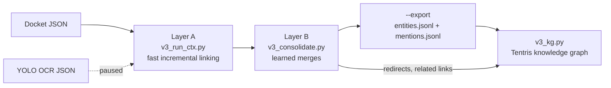

# V3_Main_EDP: entity resolution for court records

> This repository holds the V3 pipeline (Layer A, Layer B, document reader, Tentris knowledge graph). It was developed under the name V4. The older pipeline that used to be called V3 is now V3_overtime: https://github.com/nikhilgoud003/V3_overtime.

**About the name.**
- This pipeline is **V3**. Until 2026-10-15 it was called V4.
- The older pipeline that was called V3 is now **V3_overtime**: https://github.com/nikhilgoud003/V3_overtime.
- The scripts are `v3_*.py`. The knowledge-graph namespace is `v3:` (`http://scales-kg.org/v3#`). Entity ID formats (SJ, SP, SC, SF) did not change.
- Reports and folders in `~/nikhil_results` made before 2026-10-15 still say V4 (for example `V4_readme_check`, `V4_kg`, `v4_inc`). They were not renamed, so the source paths in this README still say V4.
- A graph built before the rename uses `http://scales-kg.org/v4#`. Build it again with `v3_kg.py` to get `v3:` terms.

**Contents:**

| Path | What it is |
|---|---|
| `v3_run_ctx.py`, `v3_rules.yaml` | Layer A: incremental linking, and its rules |
| `v3_consolidate.py`, `v3_consolidate.yaml`, `models/` | Layer B: learned consolidation, its settings, and the trained model with its model card |
| `v3_names.py` | name gate, organisation normalisation, display names (shared) |
| `v3_readers.py` | input readers: docket JSON, OCR documents, generic JSON |
| `v3_kg.py` | RDF emitter and Tentris loader (knowledge graph) |
| `data/` | public reference data: FJC judge list, Census name files (see `data/README.md`) |
| `test_ctx.py`, `test_consolidate.py`, `test_v3_new.py` | tests for Layer A, Layer B and the later changes |
| `v3_test_run.sh`, `v3_consolidate_run.sh` | full test procedures |
| `score.py`, `check_consolidated.py`, `doc_report.py` | scoring against the answer key, Layer B checks, document summary |

**Quick start** (details in the sections below):

```bash
source .venv/bin/activate
python v3_run_ctx.py --input /path/to/case_json --output /path/to/run                      # Layer A
python v3_consolidate.py --input /path/to/run --output /path/to/consolidated \
  --model models/model.joblib --export /path/to/export                                    # Layer B + export
python v3_kg.py build --export /path/to/export --layer-b /path/to/consolidated \
  --store /path/to/kg/store --batch-id first                                              # knowledge graph
```

**Where the numbers come from.** Every number in this README names its source file. The source files are run outputs and reports in the author's results folder `nikhil_results/`. They are not in the repo (they hold case data). Paths are relative to that folder. "Pilot" means the 1,000 pilot docket files. "TXSD" means the 50,766 docket files of one large district court.

## 1. What this is

This is entity resolution for PACER court dockets.

- It reads docket JSON files.
- It finds four kinds of names: **judges, parties, counsel (lawyers) and law firms**.
- It gives each real person or organisation one stable ID.
- It is **incremental**. You can add new files later. Old IDs never change.
- It ends in a **knowledge graph**: an RDF store (Tentris) you can query with SPARQL.

It can also read OCR output of court documents (YOLO page/block JSON). That part is paused (section 6).

## 2. Pipeline



- **Layer A** reads each file once and links each name to a saved ID, or makes a new ID.
- **Layer B** looks at all IDs together and merges IDs that are the same real entity.
- **Export** writes the final result as two files.
- **v3_kg.py** turns the export into RDF and loads it into Tentris.

## 3. Project history

| Version | What it did | What went wrong | Why we moved on |
|---|---|---|---|
| **V1** | The original SCALES code. Judges: a spaCy NER model on docket text, then matching to the FJC list. Counsel, firms and parties: separate scripts. | Slow: 2,088 s for 1,000 pilot files, almost all in judge NER and matching. Parties could not run: they need EDGAR data and a classifier module that do not exist. Hard-coded server paths, and a bug that stops the judge build step on every run. | Too slow, and not complete. |
| **V2** | The rule-based `research_dev` pipeline. Reads only the header and party-record fields. | Misses judges named only in docket text (mostly magistrates). Drops two-word judge names. Puts the U.S. Attorney's Offices of 14 districts in one firm ID. | Fast, but finds about half of the judges. |
| **V3_overtime** (the old V3) | One unified incremental pipeline for judges, firms and parties. Rules, then embeddings (local Ollama + FAISS), then an optional local LLM (qwen) for hard pairs. RDF into Tentris. | Correct on the pilot, but too slow on a full court: 8 h 49 min for TXSD on a GPU machine. Messy judge list on TXSD. Many party IDs that mix different people. | Accurate, but too slow and too many wrong party merges at full-court size. |
| **V3** (this repo; developed as V4) | Fast context-based linking (Layer A), then a learned merge step (Layer B), then a knowledge graph. | See section 11 for the problems found and fixed on the way. | — |

Numbers behind the table:

| | V1 | V2 | V3_overtime | V3 (this repo) |
|---|---|---|---|---|
| Pilot time, 1,000 files | 2,088 s | 10.4 s | 285 s (Mac), 216 s (GPU machine) | 13 s Layer A + 34 s Layer B |
| Judge extraction F1 (pilot key) | 0.916 | 0.680 | 0.966 | 0.830 |
| Party resolution F1 (pilot key) | not run | 0.955 | 0.958 | 0.926 |
| Firm resolution F1 (pilot key) | 0.828 | 0.587 | 0.788 | 0.894 |
| Full TXSD (50,766 files) | not run | 122 s | 31,721 s (8 h 49 min) | 190.3 s Layer A (pilot + TXSD, 51,766 files) |
| TXSD party IDs that mix different surnames | not run | 1,022 | 2,922 | not measured for this version |

Sources:
- V1, V2, V3_overtime pilot: `v1_compare/REPORT.md` and `eval_pilot1000_scoring/REPORT.md`.
- V2, V3_overtime TXSD: `compare_txsd_v2_v3_claude/REPORT.md`.
- V3 pilot scores: `V4_readme_check/score_readme.txt`. V3 pilot times: `V4_readme_check/logs/times.txt`.
- V3 TXSD time: `V4_run_final/logs/03_add_txsd.log`.
- V1's bug (`args['simple_outnames']` on an argparse Namespace) and missing data: `v1_compare/REPORT.md`.
- V3_overtime's 195 junk or non-judge IDs out of 798 judge IDs on TXSD: `compare_txsd_v2_v3_claude/REPORT.md`.

## 4. Layer A (`v3_run_ctx.py`)

Layer A reads each file once. For each name it finds, it links the name to a saved ID or makes a new one.

**Indexing.** Saved entities sit in an index of name keys. Judges and counsel are keyed by surname. Parties are keyed by their normalised name (organisation acronyms also by court). Firms are keyed by normalised name and office. A new mention is compared only with the entities under its key, not with everything.

**Context evidence.** A merge needs evidence beyond the name:
- judges: same court and a compatible name;
- person parties: shared counsel, shared firm or a shared co-party;
- counsel and firms: shared email, phone, address or office;
- organisation parties: the same normalised name.

**Safety rules.**
- Two different parties of one case are never merged.
- "Doe" placeholders never merge across cases.
- A name suffix conflict (Jr vs Sr) blocks a merge.
- Close pairs that are not merged go to `uncertain_pairs.jsonl`.

**The name gate (two models).** Before a name becomes an entity, the gate decides: PERSON, ORGANISATION or NOT AN ENTITY.
- Vote 1: spaCy NER (`en_core_web_md`), on the docket sentence when there is one.
- Vote 2: probablepeople (Person vs Corporation).
- Each distinct string is voted on once and cached.
- If the votes differ, data decides: a judge in the case's judge field, the FJC list, a known lawyer, firm or party.
- Then, only with `--llm local`, a local Ollama model decides.
- Anything still undecided goes to `gate_review.jsonl`.
- Judges must be PERSON. Counsel that is an organisation (an office) stays counsel and is flagged `is_organisation`.
- On the pilot, the gate saw 9,819 distinct strings in 10.4 s. Both models agreed on 2,532 judge mentions as person and 5,329 party mentions as organisation. 26 judge entries were dropped because both models said organisation. (source: `V4_readme_check/logs/01_layerA.log`)

**Pending judges.** A judge named only in docket text first tries to join a known judge. If it matches none, it waits in `pending_judges.jsonl`. Nothing is dropped.
- A pending name becomes a judge when it has a first and last name, a judge title, and appears in 3 or more cases.
- Or when it is on the FJC list and its title was seen in at least 1 case.
- It is then promoted with all its earlier mentions.
- One-word names never create a judge.
- The end-of-run step is a single pass, indexed by court and surname. The scaling test: 1,000 / 10,000 / 50,000 pending names take 0.01 s / 0.06 s / 0.41 s. (source: `V4_readme_check/logs/test_new.log`, check 1)
- On the pilot, 292 docket judge mentions are still pending at the end. (source: `V4_readme_check/layerB/report.md`)

**Roles and sides.** Each party mention keeps its role from the docket (e.g. Plaintiff, Defendant) and a side: plaintiff-side, defendant-side or other.

**Organisations.** One normalisation is shared by Layer A and Layer B (`v3_names.py`):
- "&", "and", "+", commas and periods count the same;
- legal-form parts are removed using the parser's own labels (Inc., LLC);
- text in parentheses, or after a final dash, goes to an "office" field.

**Incremental mode.** Run again on the same output folder. Files already processed are skipped (by name and sha256). Old IDs never change.
- Rerunning the same files changes nothing: all 9 output files stayed byte-identical. (source: `V4_readme_check/test_run/timings.txt` and a file compare of `run` vs `run_before_rerun`)
- Full TXSD rerun: 27.8 s, all output checksums identical. (source: `V4_run_final/logs/04_rerun_txsd.log`, `sums_before_rerun.txt` = `sums_after_rerun.txt`)

**Pilot result** (source: `V4_readme_check/logs/01_layerA.log`): 10,728 entities (judge 687, party 4,414, counsel 3,595, firm 2,032), 20,134 mentions, 267 uncertain pairs, 12.5 s.

## 5. Layer B (`v3_consolidate.py`)

Layer B runs after Layer A. It merges IDs that belong to the same real person or organisation.

**Entity cards.** Each Layer A ID becomes a card: its name variants, cases, courts, divisions, dates, co-occurring entities, party side, and contact details.

**Candidate pairs.** Only pairs of the same type that share a case, or are in the same court with similar names (character n-gram TF-IDF cosine ≥ 0.4299), are scored. The filter keeps 120 of 120 labelled same-court true pairs. (source: `models/model_card.md`) On the pilot this gives 296,553 candidate pairs. (source: `V4_readme_check/layerB/report.md`)

**The learned model.** A calibrated gradient-boosting model scores each pair. (source: `models/model_card.md`)
- Two models were compared on held-out courts. Gradient boosting: average precision 0.9893. Logistic regression: 0.9820. Gradient boosting was kept.
- Training labels came from three sources: the pilot answer key, the FJC list, and automatic name fragments (7,290 synthetic fragments).
- Folds are grouped by court: a test court is never seen in training.
- Features include name similarity, name subset, first-name compatibility, shared cases, same division, co-occurring entities, dates, titles and party side.

**Thresholds.** A pair kind merges automatically only where held-out precision stays ≥ 0.98. (source: `models/model_card.md`, `V4_readme_check/layerB/report.md`)
- Merge thresholds: counsel 0.7535, judge 0.3287, person parties 0.8315.
- Firms and organisation parties never reached 0.98, so they never auto-merge. Their pairs go to review or become RELATED links.
- Pairs between 0.6749 and the merge threshold go to the review queue.
- Held-out precision over all kinds at the merge thresholds: 0.9834, recall 0.8921.

**Organisations.** Each organisation pair ends as SAME (merge), RELATED (an office, or a parent / subsidiary: both IDs kept and linked) or DIFFERENT. On the pilot: 203 RELATED links. (source: `V4_readme_check/layerB/report.md`)

**Redirects.** A merge writes `old ID -> surviving ID` to `redirects.jsonl`. Redirects are never undone. The surviving ID is the oldest one.

**Review queue.** Pairs the model is unsure about go to `review_queue.jsonl`. On the pilot: judge 1, party 22, counsel 1, firm 56. (source: `V4_readme_check/layerB/report.md`)

**Pilot result** (source: `V4_readme_check/layerB/report.md`):

| type | Layer A IDs | after Layer B | merged away |
|---|---|---|---|
| judge | 687 | 681 | 6 |
| party | 4,414 | 4,392 | 22 |
| counsel | 3,595 | 3,589 | 6 |
| firm | 2,032 | 2,032 | 0 |

Time: 32.4 s. Adding 500 TXSD files later: only 4,089 pairs were scored, in 3.8 s. (source: `V4_kg/runs_v2/layerB_2_pilot_txsd500/report.md`)

**--export.** `--export <folder>` writes the final result as exactly two files: `entities.jsonl` and `mentions.jsonl` (section 8).

## 6. Document reader (YOLO OCR JSON)

**Status: paused.** It was tuned on only 7 files. It needs a new, separate test set before anyone trusts it.

It reads OCR output where each file has `filename` and `pages[].blocks[]` with `class`, `confidence`, `bbox` and `text`. The reader is chosen by the file's structure, not its name.

How it works:
- **Models, not lists.** spaCy NER runs on every reading unit. GLiNER2 runs only on units where spaCy finds a person or organisation, or where contact details appear. Results are cached.
- **Document gate.** A person needs spaCy PERSON and probablepeople Person. An organisation needs positive evidence: spaCy ORG, a legal-form part, or a high organisation score.
- **Form text.** A line repeated across two or more documents is treated as form text, unless gate-approved names cover it.
- **Labels.** Each value line keeps its nearest short form label (paired by bbox). A label for a non-participant role (for example a payee) makes the name "mentioned only".
- **Relations.** A signature is linked to the firm or address that follows it, also across a page break. A person with a bar number, a law firm or an address is counsel.
- **One role per name per case.** Docket roles of the same case override document guesses.

On the 7 test files: 22.47 s in total. The gate approved 36 persons and 41 organisations and sent 108 names to review. (source: `V4_yolo_round2/document_report.jsonl`)

Known problems on those 7 files:
- An official named in a form's return section can become a party.
- A real name with a low model score and no label pointing to it goes to review.
- OCR debris that both models accept can still appear in `mentioned_only.jsonl`.

## 7. Knowledge graph (`v3_kg.py`)

`v3_kg.py` writes the export and the Layer B links as RDF and loads them into a Tentris store.

**Tentris.** Version 1.1.0, at `~/.local/bin/tentris`, or set `TENTRIS_BIN`. The store is served on 127.0.0.1 only, on a free port chosen at start (never 9080). The port is written to `<store>/.tentris_port`.

**Commands** (each was run on the pilot + 500 TXSD data):

```bash
python v3_kg.py start  --store <store_folder> [--port N]
python v3_kg.py stop   --store <store_folder>
python v3_kg.py emit   --export <export_folder> --layer-b <layerB_folder> --out <file.nt>
python v3_kg.py build  --export <export_folder> --layer-b <layerB_folder> --store <new_store_folder> --batch-id <id>
python v3_kg.py add    --export <export_folder> --layer-b <layerB_folder> --store <store_folder> --batch-id <id>
python v3_kg.py counts --export <export_folder> --store <store_folder>
python v3_kg.py query  --store <store_folder> [--example 1..5 | --sparql "<query>"]
python v3_kg.py prove  --export-1 <E1> --layer-b-1 <B1> --export-2 <E2> --layer-b-2 <B2> --work <new_folder>
```

- `build` needs a new, empty store folder. It loads with `tentris load`, then serves.
- `add` needs a running store.
- `emit` writes the triples to a file and prints the validation report.

**Prefixes:**

| Prefix | IRI | Used for |
|---|---|---|
| `pacer:` | `http://scales-kg.org/pacer#` | the SCALES PACER terms V3_overtime used: `Judge`, `Party`, `LawFirm`, `JudgeMention`, `PartyMention`, `FirmMention`, `Case`, `hasName`, `hasSJID` / `hasSPID` / `hasSFID`, `hasCode`, `hasUcid`, `mentionsIn`, `resolvedTo`, `hasRole`, `hasCounselOffice` |
| `v3:` | `http://scales-kg.org/v3#` | terms V3 adds: `Attorney`, `AttorneyMention`, `hasSCID`, `MergedRecord`, `mergedInto`, `officeLink`, `parentOrSubsidiaryLink`, `plaintiffParty` / `defendantParty` / `otherParty`, `hasJudge`, `hasAttorney`, `represents`, `isOrganisation`, side counts, `sourceDocument` |
| `skos:` | `http://www.w3.org/2004/02/skos/core#` | `prefLabel` (display name), `altLabel` (name variants) |

**IRI patterns:**

| Thing | IRI |
|---|---|
| judge `ent_SJ_000123` | `http://scales-kg.org/id/judge/SJ000123` |
| party `ent_SP_…` | `http://scales-kg.org/id/party/SP…` |
| counsel `ent_SC_…` | `http://scales-kg.org/id/counsel/SC…` |
| firm `ent_SF_…` | `http://scales-kg.org/id/firm/SF…` |
| case | `http://scales-kg.org/id/case/<url-encoded ucid>` |
| mention | `http://scales-kg.org/id/mention/<mention_id>` |

**Validation** runs before every load: the triples parse, every entity has a type and a name, and no link points to an untyped node. Pilot: 200,857 triples, 0 entities without a name, 0 dangling links. (source: `V4_kg/load_log.jsonl`)

**How incremental add works.**
1. Emit all triples for the new export.
2. Compare them with the last loaded state (`state_loaded.nt` in the store folder).
3. Send SPARQL `DELETE DATA` for triples that are gone (for example a changed display name or a merged-away ID).
4. Send `INSERT DATA` for new triples.
5. Write one line to `load_log.jsonl`.

**Proof** (sources: `V4_kg/proof.json`, `V4_kg/load_log.jsonl`):

| Check | Result |
|---|---|
| Build the pilot | 200,857 triples in 3.28 s |
| Add 500 TXSD files incrementally | +54,156 / −10 triples, 255,003 in total, 4.36 s |
| Same batch again | +0 / −0 |
| Force-insert every triple again | 0 inserted |
| Incremental store vs a fresh build of both batches | 255,003 = 255,003 triples; 0 only in one store, 0 only in the other |
| Entity counts, graph vs export | equal: judge 690, party 4,995, firm 2,066, counsel 3,715 |

**The Tentris web console.** Open `http://127.0.0.1:<port>/` in a browser, with the port from `<store>/.tentris_port`. It opens the "Tentris Admin Console". The Tentris binary contains a page called "SPARQL Editor", reached from inside the console. `/sparql-editor` cannot be opened directly (it returns 404). Only the console page loading (HTTP 200) was checked, not the editor in a browser.

**Example queries.** Run them with `python v3_kg.py query --store <store_folder> --sparql "<query>"`, or paste them into the SPARQL Editor. Each was run on the pilot + 500 TXSD store. The result sizes are from `V4_readme_check/kg_queries/*.json`. Every query starts with:

```sparql
PREFIX pacer: <http://scales-kg.org/pacer#>
PREFIX v3:    <http://scales-kg.org/v3#>
PREFIX skos:  <http://www.w3.org/2004/02/skos/core#>
```

1. Number of triples (result: 255,003):
   ```sparql
   SELECT (COUNT(*) AS ?n) WHERE { ?s ?p ?o }
   ```
2. Entities by type (10 rows; for example Party 4,995, Judge 690):
   ```sparql
   SELECT ?type (COUNT(?e) AS ?n) WHERE { ?e a ?type } GROUP BY ?type ORDER BY DESC(?n)
   ```
3. Top 10 judges by number of cases (top judge: 469 cases):
   ```sparql
   SELECT ?judge ?name (COUNT(DISTINCT ?case) AS ?cases)
   WHERE { ?case v3:hasJudge ?judge . ?judge pacer:hasName ?name }
   GROUP BY ?judge ?name ORDER BY DESC(?cases) LIMIT 10
   ```
4. All cases of one judge (469 rows for the top judge). Put a judge IRI from query 3 in place of `SJ000001`:
   ```sparql
   SELECT ?ucid WHERE { ?case v3:hasJudge <http://scales-kg.org/id/judge/SJ000001> . ?case pacer:hasUcid ?ucid } ORDER BY ?ucid
   ```
5. Parties in one case, by side. Put a ucid from query 4 in place of `<ucid>`:
   ```sparql
   SELECT ?side ?name WHERE {
     ?case pacer:hasUcid "<ucid>" .
     { ?case v3:plaintiffParty ?p BIND("plaintiff" AS ?side) } UNION
     { ?case v3:defendantParty ?p BIND("defendant" AS ?side) } UNION
     { ?case v3:otherParty ?p BIND("other" AS ?side) }
     ?p pacer:hasName ?name } ORDER BY ?side ?name
   ```
6. All lawyers for one party (337 rows for the party with the most lawyers):
   ```sparql
   SELECT ?lawyer WHERE { ?a v3:represents <http://scales-kg.org/id/party/SP000002> . ?a pacer:hasName ?lawyer } ORDER BY ?lawyer
   ```
7. Layer B merges (41 rows: 8 judge, 26 party, 7 counsel):
   ```sparql
   SELECT ?old ?survivor ?name WHERE { ?old v3:mergedInto ?survivor . ?survivor pacer:hasName ?name } ORDER BY ?old
   ```

`python v3_kg.py query --store <store_folder>` runs five built-in examples. Each one picks its subject with an earlier query.

## 8. Output files

**Layer A output folder:**

| File | Contents |
|---|---|
| `entities.jsonl` | the entities |
| `mentions.jsonl` | every mention, with its context, role and side |
| `state.json` | ID counters and processed files |
| `uncertain_pairs.jsonl` | close pairs that were not merged |
| `pending_judges.jsonl` | docket judge names not yet promoted |
| `dropped_entities.jsonl` | every drop, with the gate votes where the gate decided |
| `gate_review.jsonl` | names the gate could not decide |
| `name_gate_cache.jsonl` | model votes per distinct string |
| `document_review.jsonl` | document rows to check (low confidence, case-number mismatch, conflicting roles) |
| `mentioned_only.jsonl` | names found only inside document text, not in a participant slot (only when there are any) |
| `document_report.jsonl` | per document: time, units sent to GLiNER2, gate decisions; plus the calibrated thresholds (documents only) |
| `document_model_cache.jsonl` | document model results (documents only) |

**Layer B output folder:**

| File | Contents |
|---|---|
| `entities_consolidated.jsonl` | final entities, with `merged_from`, `related` and party side counts |
| `redirects.jsonl` | old ID -> surviving ID |
| `mentions_resolved.jsonl` | every mention with its final ID |
| `related_links.jsonl` | organisation pairs linked as RELATED |
| `review_queue.jsonl` | pairs left for review |
| `consolidation_state.json` | state for incremental runs |
| `report.md` | merges, RELATED links, organisation names still split, review queue, time, court-held-out pilot scores |
| `model_card.md` | the model's features, weights, thresholds and training pairs |

**`--export` folder:**

| File | Contents |
|---|---|
| `entities.jsonl` | final entities with variants, courts, cases and related IDs; parties carry plaintiff / defendant / other counts; parties and counsel carry `is_organisation` |
| `mentions.jsonl` | every mention with its details, role / side, `is_organisation` and FINAL entity ID; pending docket judge names have a null ID |

**Knowledge graph:**

| File | Contents |
|---|---|
| `<store>/db/` | the Tentris database |
| `<store>/state_loaded.nt` | every triple of the last load (used by `add` to find the difference) |
| `<store>/.tentris_port`, `<store>/.tentris_pid` | the port and process of the running server |
| `<store>/tentris.log` | the server log |
| `load_log.jsonl` (next to the store folder) | one line per load: batch id, time, triples emitted / inserted / removed, total, validation |
| `proof.json` (in the `prove` work folder) | the results of the four proof checks and the five examples |

## 9. How to run

**Setup.** Python 3.13.1 was used (source: `requirements.txt`).

```bash
python3 -m venv .venv
source .venv/bin/activate
pip install -r requirements.txt
python -c "import spacy, probablepeople; spacy.load('en_core_web_md'); print('ok')"
```

- `requirements.txt` installs the spaCy model `en_core_web_md` 3.8.0 directly.
- GLiNER2 (document reader only) downloads its model on first use.
- Ollama is optional (`--llm local`). The model and URL are set in `v3_rules.yaml` under `name_gate.ollama`.
- Tentris 1.1.0 is a separate binary (section 7).

**Pilot -> add 500 TXSD -> rerun -> all at once.** These are the steps of `v3_test_run.sh`:

```bash
python v3_run_ctx.py --input <pilot_folder> --output <run_folder>
python v3_run_ctx.py --input <txsd500_folder> --output <run_folder>
python v3_run_ctx.py --input <txsd500_folder> --output <run_folder>
python v3_run_ctx.py --input <pilot_folder> <txsd500_folder> --output <oneshot_folder>
```

Or all four steps with checks:

```bash
PYTHON=$(which python) ./v3_test_run.sh <new_test_folder> <pilot_folder> <txsd500_folder>
```

Result on the current code (source: `V4_readme_check/test_run/timings.txt` and `log_*.txt`):

| Step | Time | Result |
|---|---|---|
| pilot | 11.6 s | 10,728 entities, 20,134 mentions |
| add 500 TXSD | 4.1 s | 11,507 entities, 29,469 mentions |
| rerun the same 500 | 1.5 s | no change: every output file byte-identical |
| all 1,500 at once | 13.1 s | 11,507 entities, 29,397 mentions |

Note: the script still checks a file called `type_cache.jsonl`, which the current code no longer writes. So that one line always says "CHANGED". The other files were compared by hand: all 9 identical.

**Layer B, then export:**

```bash
python v3_consolidate.py --input <run_folder> --output <layerB_folder> --model models/model.joblib --export <export_folder>
```

Run it again after adding files: only new or changed IDs are scored, and old redirects are kept. Keep a copy of the Layer B folder per stage if you want to rebuild an earlier stage, because `related_links.jsonl` is rewritten on every run.

**Knowledge graph:**

```bash
python v3_kg.py build --export <export_folder> --layer-b <layerB_folder> --store <new_store_folder> --batch-id pilot
python v3_kg.py add   --export <next_export_folder> --layer-b <next_layerB_folder> --store <store_folder> --batch-id next
tail -n 3 <store_parent_folder>/load_log.jsonl
```

**Other options:**

```bash
python v3_run_ctx.py --input <folder> --output <run_folder> --llm local
python v3_run_ctx.py --input <folder> --output <run_folder> --doc-model ollama
python v3_run_ctx.py --input <folder> --output <run_folder> --rules <rules_file>
python v3_consolidate.py --input <run_folder> --output <new_model_folder> --key <answer_key_folder>
python doc_report.py <layer_A_output_folder> --names
```

- `--llm local`: a local Ollama model settles name-gate disagreements (answers cached).
- `--doc-model ollama`: documents are read with Ollama instead of GLiNER2.
- `--rules`: another rules file. Data paths in it are relative to that file.
- `--key` without `--model`: trains a new Layer B model.
- `doc_report.py`: a per-document summary of a document run.

**While it runs:**
- Layer A prints `Progress:`, `Name gate:` and `End step:` lines.
- `kill -USR1 <pid>` prints where the run is, without stopping it.
- Every output file is written to a temp file and renamed, so a stopped run never leaves a half-written file.

## 10. Tests and evaluation

**Unit tests** (source: `V4_readme_check/logs/test_a.log`, `test_b.log`, `test_new.log`):

```bash
V3_PILOT_DIR=<pilot_folder> python test_ctx.py <new_folder_a>
python test_consolidate.py <new_folder_b>
V3_PILOT_DIR=<pilot_folder> python test_v3_new.py <new_folder_new>
```

| Suite | Checks | Result |
|---|---|---|
| `test_ctx.py` (Layer A; one check needs the 1,000 pilot files) | 49 | 49 passed |
| `test_consolidate.py` (Layer B, synthetic data) | 13 | 13 passed |
| `test_v3_new.py` (pending-judge scaling, name gate, organisation names, export, readers, safe saving, no real names in code) | 22 | 22 passed |

Full procedures: `v3_test_run.sh` (section 9) and `v3_consolidate_run.sh <test_folder>` (Layer B on the folder made by `v3_test_run.sh`).

**Scoring.** `score.py` scores a run against the answer key:

```bash
python score.py --key <answer_key_folder> --v3dir V3=<layer_A_run_folder> --out <score.json>
```

**The answer key is not in the repo.** It covers 200 pilot files and was made by one reviewer following written rules (source: `eval_pilot1000_scoring/REPORT.md`). P = precision, R = recall. Extraction = the right name in the right file. Resolution = pairs of mentions with the same ID.

**Results on the current code** (source: `V4_readme_check/score_readme.txt`; 95% bootstrap range of F1 in brackets):

| Type | Extraction P / R / F1 | Resolution P / R / F1 |
|---|---|---|
| judge | 0.928 / 0.751 / 0.830 [0.801, 0.861] | 1.000 / 1.000 / 1.000 |
| party | 0.998 / 0.998 / 0.998 [0.996, 0.999] | 0.984 / 0.874 / 0.926 [0.864, 0.973] |
| firm | 0.981 / 0.980 / 0.981 [0.971, 0.989] | 0.996 / 0.811 / 0.894 [0.75, 0.934] |

- Layer A and Layer B give the same scores on the pilot key. (source: same file; Layer B rows scored from the export, without the pending judge names)
- Layer B's own report scores each pilot court with a fold model that never saw that court. It gets the same numbers. (source: `V4_readme_check/layerB/report.md`)
- Counsel is not in the key, so it is not scored.

**Earlier systems on the same key** (F1; sources: `v1_compare/REPORT.md`, `eval_pilot1000_scoring/REPORT.md`):

| Type | Score | V1 | V2 | V3_overtime bulk | V3_overtime with qwen | V3 now |
|---|---|---|---|---|---|---|
| judge | extraction | 0.916 | 0.680 | 0.966 | 0.970 | 0.830 |
| judge | resolution | 0.985 | 1.000 | 0.999 | 0.999 | 1.000 |
| party | extraction | not run | 0.997 | 0.998 | 0.998 | 0.998 |
| party | resolution | not run | 0.955 | 0.958 | 0.958 | 0.926 |
| firm | extraction | 0.812 | 0.932 | 0.980 | 0.980 | 0.981 |
| firm | resolution | 0.828 | 0.587 | 0.788 | 0.787 | 0.894 |

## 11. Lessons learned

**1. The party F1 collapse.**
- What happened: one earlier version linked a party across cases only with evidence (shared counsel, firm or co-party). Party resolution F1 fell from 0.890 to 0.282 (recall 0.164). 1,427 of the 1,968 lost pairs (73%) were the government party: its 54 mentions in the key files got 50 IDs. (source: `v4_inc/REPORT_ctx.md`)
- Fix: the government party ("United States", "USA" …) folds to one ID, and organisation parties with the same normalised name share one ID. Party resolution F1 went back up to 0.973. (source: `v4_inc/REPORT_ctx2.md`)

**2. The docket-judge rule that wiped out magistrates.**
- What happened: a clean-up rule said "docket text never creates a judge ID". Magistrates mostly appear only in docket text, and they are not on the FJC list. On TXSD, 36,503 docket mentions were dropped and judge IDs fell from 402 to 64. (source: `v4_inc/REPORT_cleanup.md`)
- Fix: the pending pool (section 4). Nothing is dropped. A pending name is promoted after 3 cases with a title, or 1 case if it is on the FJC list. Pilot judge extraction F1 went from 0.8118 to 0.8257. (source: `v4_inc/REPORT_cleanup_fix.md`) It is 0.830 now. (source: `V4_readme_check/score_readme.txt`)

**3. The TXSD hang at 50,500 files.**
- What happened: the full TXSD run reached file 50,500 of 50,766 and never finished. The log has no final totals line, and nothing was saved. (source: `V4_Main_test/logs/03_layerA_add_txsd.log`) The cause was the end-of-run pending-judge step: it promoted one name per round and then re-checked every pending name. (source: `v4_inc/REPORT_cleanup_fix.md`)
- Fix: one pass, indexed by court and surname. Time now grows about linearly with the number of pending names (section 4). Also added: progress lines for every end step, `kill -USR1` to show where a run is, and safe saving. Pilot + full TXSD (51,766 files) now takes 190.3 s. (source: `V4_run_final/logs/03_add_txsd.log`)

**4. The "Corp." recall drop.**
- What happened: organisation names used to lose a word list of legal forms (inc, corp, corporation, co, company …). Now they lose only the parts the parser labels as a legal type. The parser labels "Corp.", "Corporation" and "Company" as organisation words, not legal forms. So "Acme Corp." and "Acme Corporation" stay two IDs. Party resolution recall fell from 0.952 to 0.874. (sources: `v4_inc/score_final.txt` and `V4_readme_check/score_readme.txt`)
- Fix: **not made; still open.** A setting exists: `organisations.legal_form_rule: legal_type_and_trailing_org_type` in `v3_rules.yaml`. It also removes one final organisation word. On the pilot it gives party resolution P 0.981 / R 0.930 / F1 0.955, against 0.984 / 0.874 / 0.926 with the default. (source: `V4_readme_check/score_readme.txt`, rows CorpA / CorpB) The default was not changed. Only Layer A reads this setting.

## 12. Design rules

- **No hard-coded names or keyword lists** for deciding what is a name. Use pretrained models, public reference data (FJC, Census) and statistics from the data. Every list and number that remains is in `v3_rules.yaml` or `v3_consolidate.yaml`, with a `source:` note. The tests check that no real names appear in the code or settings.
- **Old IDs never change.** Incremental runs only add. Layer B only adds redirects, and the surviving ID is the oldest one.
- **Precision first.** A merge needs evidence. Layer B merges automatically only where held-out precision is ≥ 0.98.
- **Unsure cases go to review files**, not into the data: `uncertain_pairs.jsonl`, `gate_review.jsonl`, `pending_judges.jsonl`, `review_queue.jsonl`, `document_review.jsonl`.

**Lists that remain, and why:**
- **Field and format structure:** JSON field names; the docket phrases that locate a judge name; case-number, email, phone, ZIP and bar-number patterns; side by party role.
- **Name cleaning before matching:** title words ("Judge", "Hon."), name suffixes (Jr, Sr, III), counsel office tags ("-DOJ"), a leading "the" for organisations. These make keys comparable. They never decide whether a string is a name.
- **Matching rules the user set:** the government-party fold; per-district U.S. Attorney and Federal Public Defender offices; Doe placeholders; nicknames for first-name compatibility; webmail domains (not evidence).
- **Court-staff roles:** a counsel entry naming a role such as interpreter, probation or clerk is court staff.
- **Model label names:** spaCy's labels mapped to the three gate outcomes; the GLiNER2 label descriptions.

## 13. Known limits and open items

- **Full TXSD is not in the knowledge graph yet.** The graph was built and tested on the pilot + 500 TXSD files only. (source: `V4_kg/load_log.jsonl`)
- **Layer B has not been run on full TXSD.** Layer A has: 149,767 entities, 798,166 mentions. (source: `V4_run_final/logs/03_add_txsd.log`)
- **No test on a held-out court with its own answer key.** All scores use the pilot key. Layer B's court-held-out numbers are folds over the pilot courts, not a new court.
- **"Usa" display casing.** The government party's display name shows as "Usa". (source: `V4_readme_check/kg_queries/q5_case_sides.json`)
- **The "Corp." fix is open** (section 11, item 4).
- **The document reader (YOLO) is paused** (section 6).
- **Incremental vs all at once is not fully equal for judges.** Pilot + 500 TXSD added incrementally gives 72 more judge mentions than all 1,500 at once. All 72 are docket mentions in the added files, attached to 2 already-known judges. Entity counts are equal (11,507). The cause was not investigated. (source: `V4_readme_check/test_run/run` vs `run_oneshot`)
- **Firms and organisation parties never auto-merge in Layer B.** On the pilot, 59 organisation names are identical after normalisation but still split into 151 IDs. (source: `V4_readme_check/layerB/report.md`)
- **The Layer B LLM check is notes only.** It needs labelled pilot pairs, which contain party names and were removed from `models/model.joblib`.
- **Repeat officials can still be split** when they are named differently with no shared context.
- **The name gate is not perfect.** Unusual names can get split votes and end in `gate_review.jsonl`.

## 14. Repo layout

```
.
├── README.md
├── requirements.txt
├── v3_run_ctx.py            Layer A
├── v3_rules.yaml            Layer A rules and settings (with source notes)
├── v3_consolidate.py        Layer B
├── v3_consolidate.yaml      Layer B settings (with source notes)
├── v3_names.py              name gate, organisation normalisation, display names
├── v3_readers.py            docket / OCR document / generic JSON readers
├── v3_kg.py                 knowledge graph (RDF + Tentris)
├── models/
│   ├── model.joblib         trained Layer B model
│   └── model_card.md        features, thresholds, training pairs
├── data/
│   ├── README.md            sources of the reference data
│   ├── judges_fjc.csv       FJC judge list
│   └── census1990_dist.*    Census 1990 name files
├── test_ctx.py              Layer A tests
├── test_consolidate.py      Layer B tests
├── test_v3_new.py           tests for the later changes
├── v3_test_run.sh           Layer A procedure: first -> add -> rerun -> all at once
├── v3_consolidate_run.sh    Layer B procedure
├── score.py                 scoring against the answer key
├── check_consolidated.py    Layer B checks
└── doc_report.py            per-document summary
```
